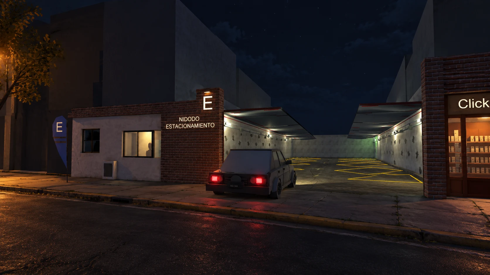

# La cochera de Nidodo

> Una web para conocer el juego, acompañar su desarrollo y jugar una demo desde el navegador.

Proyecto del **Grupo 09** para **Proyecto de Desarrollo de Aplicaciones Web**, de la Tecnicatura Universitaria en Programación Web y Móvil — DCIC, Universidad Nacional del Sur.



## Ficha del proyecto

| Aspecto | Descripción |
| --- | --- |
| Propuesta | Presentar un videojuego independiente de terror laboral argentino y reunir una comunidad que acompañe su desarrollo. |
| Usuarios | Visitantes, usuarios registrados, contribuyentes y administradores. |
| Funciones principales | Información del juego, galería, cuentas de usuario, aportes para acceder a la demo, novedades y foro. |
| APIs que vamos a utilizar | API de inicio de sesión de Google para ingresar con una cuenta de Google y API de Mercado Pago para recibir donaciones al proyecto. Ambas integraciones están pendientes. |
| Tecnologías actuales | HTML, CSS, JavaScript, Node.js, Express y una exportación Unity WebGL. |
| Persistencia | Repositorio de usuarios con almacenamiento en JSON, todavía pendiente de conectar al registro. |

### Reglas del proyecto

- La información del juego puede consultarse sin una cuenta.
- El ingreso previsto ofrece email y contraseña, además de Google.
- Un aporte aprobado habilitará la demo de forma permanente para la cuenta correspondiente.
- Ser contribuyente es una condición del usuario; Administrador es una clase que hereda de Usuario.
- El administrador podrá gestionar usuarios y accesos, publicar novedades y moderar el foro.
- Una revocación administrativa no deberá revertirse por realizar otro aporte. Ese bloqueo todavía debe implementarse.

## Equipo

| Integrante | GitHub |
| --- | --- |
| Leandro Liverotti | [leanliverotti](https://github.com/leanliverotti) |
| Darío Pokorny | [dariopokorny](https://github.com/dariopokorny) |

Los roles de trabajo se distribuyen y rotan entre los integrantes durante el desarrollo.

## Estado actual

| Parte | Estado |
| --- | --- |
| Inicio responsive | Implementado: presentación, características, galería y sección de demo. |
| Navegación y pie compartidos | Implementados mediante componentes reutilizables. |
| Demo WebGL | Disponible públicamente en `/demo/` para pruebas. |
| Registro | Formulario maquetado en `/Registro.html`; todavía sin conexión al servidor. |
| Usuario y Administrador | Clases implementadas con métodos de perfil y permisos. |
| Repositorio de usuarios | Implementado; permite cargar, guardar, buscar y actualizar usuarios y administradores. |
| Autenticación y sesiones | Pendientes de integración. |
| Google y Mercado Pago | Pendientes de integración. |
| Acceso a la demo según permisos | Pendiente: el desenfoque de Inicio es solamente visual. |
| Foro, novedades y panel de administración | Pendientes. El enlace a `/foro.html` está preparado, pero la página aún no existe. |

Actualmente los botones de ingreso y aportes de Inicio muestran avisos temporales. No se realizan cobros ni se exige una cuenta para abrir la demo de prueba. No hay endpoints REST propios conectados en `server.js` todavía.

## Cómo ejecutar el proyecto

Se necesita **Node.js 18 o superior**, npm y Git. Para jugar la demo se recomienda una computadora con teclado y mouse.

```bash
git clone https://github.com/PDAW-Proyectos/pdaw-2026-proyfinal-g09.git
cd pdaw-2026-proyfinal-g09
npm install
npm start
```

El repositorio es privado: para clonarlo se necesita acceso en GitHub. Si ya tenés la carpeta, ejecutá los dos comandos de npm desde su raíz.

Abrí [http://localhost:3000/](http://localhost:3000/). Para detener el servidor, presioná **Ctrl+C** en la terminal.

| Dirección | Contenido |
| --- | --- |
| `/` | Página principal. |
| `/Registro.html` | Maqueta del formulario de registro. |
| `/demo/` | Demo jugable exportada desde Unity. |

La demo descarga aproximadamente **106 MB** al abrirse por primera vez; puede tardar en cargar. Controles: **WASD** para caminar, **E** para interactuar y **Escape** para pausar. No hace falta instalar Unity para servir la exportación incluida.

El servidor escucha en `127.0.0.1`, por lo que está disponible únicamente en la computadora que lo ejecuta. Si el puerto 3000 está ocupado, detené el servidor anterior o elegí otro puerto. En PowerShell:

```powershell
$env:PORT = 3001
npm start
```

Por ahora no se necesitan claves de Google ni Mercado Pago para ejecutar la maqueta y la demo.

## Organización de archivos

```text
├── server.js                    # Servidor Express
├── package.json                 # Dependencias y comando de inicio
├── public/                      # Archivos que recibe el navegador
│   ├── index.html
│   ├── Registro.html
│   ├── css/                     # comun.css e inicio.css
│   ├── js/                      # Componentes compartidos y lógica de Inicio
│   └── img/                     # Icono, ilustraciones y capturas
├── src/                         # Clases del servidor
│   ├── Usuario.js
│   ├── Administrador.js
│   └── services/
│       └── RepositorioUsuarios.js
├── routes/                      # Carpeta preparada para las rutas de la API
├── data/                        # Persistencia local, fuera de public
├── docs/                        # Diagramas y wireframe
└── La-cochera-exportacion-web/   # Exportación Unity servida desde /demo/
```

### Almacenamiento de usuarios

`RepositorioUsuarios` sigue la organización del proyecto anterior: mantiene un arreglo en memoria y lo guarda en un archivo JSON. Ofrece `cargar()`, `guardar()`, `agregarUsuario()`, `actualizarUsuario()`, `listar()`, `buscarPorId()` y `buscarPorEmail()`.

Al conectarlo al servidor se debe crear una sola instancia con la ruta `data/usuarios.json` y llamar a `cargar()` al iniciar. Si el archivo no existe, se crea vacío. Recupera instancias de Usuario o Administrador según su rol y rechaza IDs y emails duplicados.

`data/usuarios.json` está excluido de Git y no se publica desde Express. Los cambios en memoria deben guardarse para conservarse tras un reinicio. Esta implementación está pensada para un solo proceso del servidor. Las contraseñas y las sesiones todavía no están implementadas.

### Componentes compartidos

Para reutilizar la cabecera y el pie en otra pantalla, incluir `/css/comun.css` y `/js/componentes.js` con `defer`. Luego colocar `<cabecera-sitio></cabecera-sitio>` antes de `<main id="contenido">` y `<pie-sitio></pie-sitio>` después, una vez por página. Requieren JavaScript habilitado. Los estilos exclusivos de Inicio están en `public/css/inicio.css`.

## Documentación y seguimiento

- [Diagrama de contexto](docs/diagrama-contexto.jpeg).
- [Diagrama de clases de dominio](docs/diagrama-clases-dominio.jpeg).
- [Mapa de navegabilidad](docs/mapa-navegabilidad.jpeg).
- [Wireframe de la pantalla principal](docs/wireframe-inicio.jpeg).
- [Backlog y tareas](https://github.com/PDAW-Proyectos/pdaw-2026-proyfinal-g09/issues).
- [Pull requests](https://github.com/PDAW-Proyectos/pdaw-2026-proyfinal-g09/pulls).

Cada cambio se trabaja en una rama y se integra mediante un pull request vinculado a la tarea correspondiente. Se busca mantener los cambios acotados para facilitar la revisión.

## Recursos visuales

La portada usa una ilustración del proyecto, identificada como tal. La galería muestra capturas reales de la entrada, el pasillo y la garita. Las imágenes nuevas se sirven en WebP y la galería utiliza carga diferida. El icono fue aportado por el equipo.
