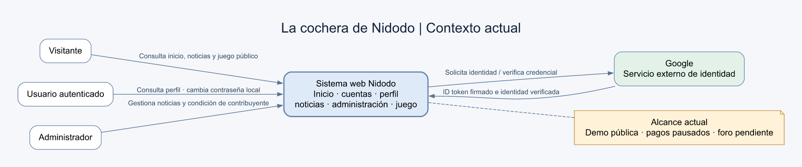
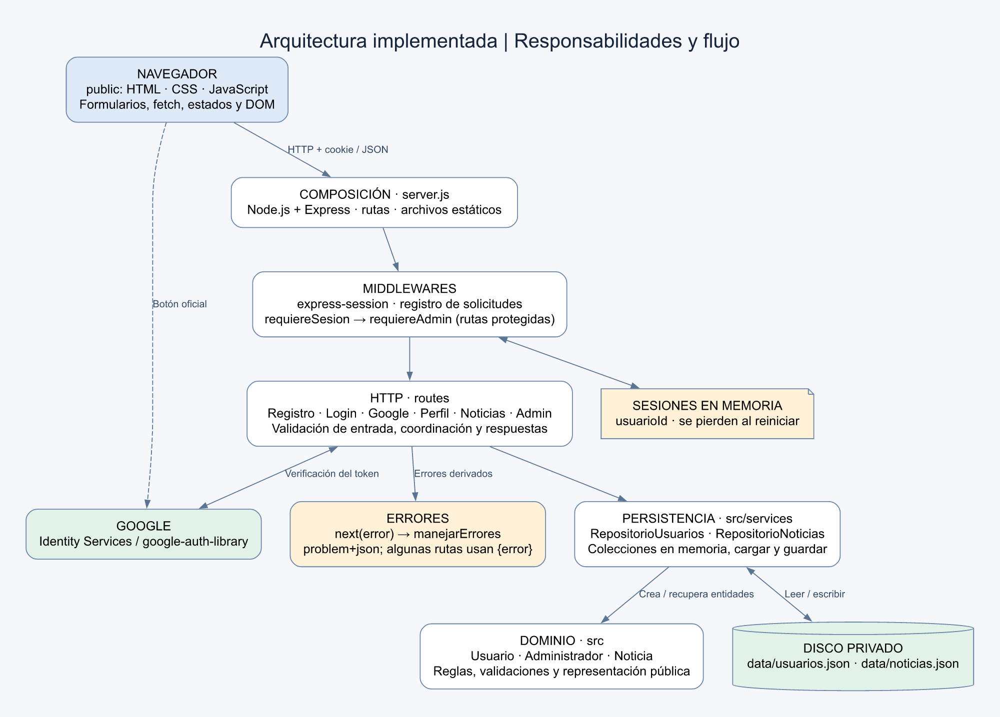
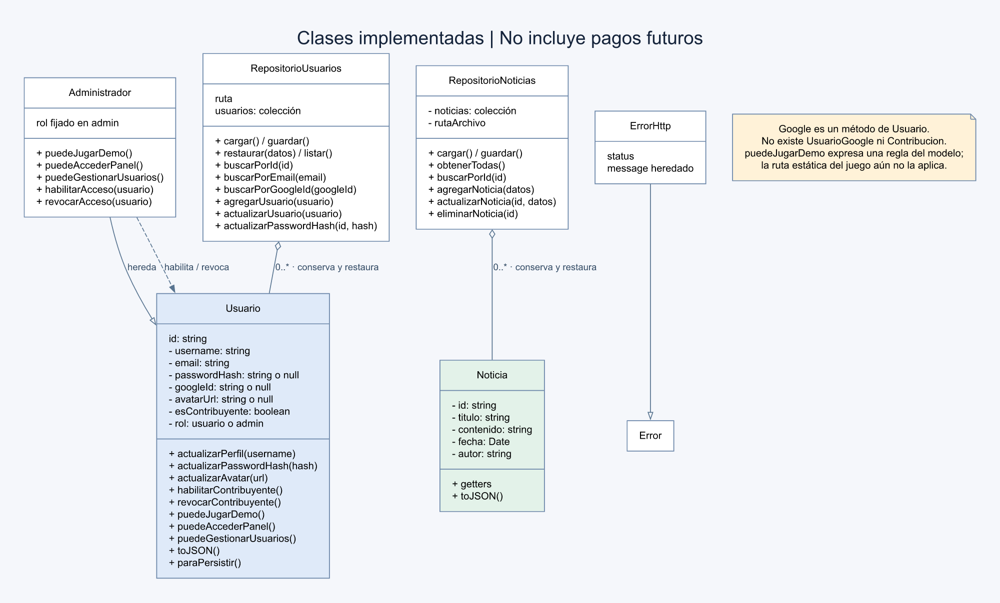
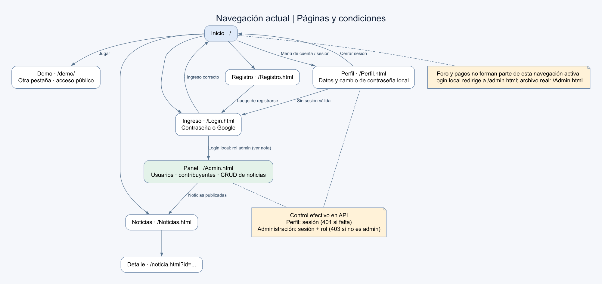

# Documentación del proyecto

Documentación del código basado en main `052a410`, revisada el 24 de noviembre de 2026. Describe la implementación existente y señala sus límites; no incorpora pagos, foro ni despliegue.

| Documento | Contenido |
| --- | --- |
| [Contrato de API](contrato-api.md) | Endpoints, permisos, datos, respuestas y errores. |
| [Arquitectura](arquitectura.md) | Contexto, capas, clases, navegación y recorridos. |
| [ADR 001](decisiones/001-sesiones-con-cookie.md) | Sesiones del servidor y cookie. |
| [ADR 002](decisiones/002-persistencia-json.md) | Repositorios y archivos JSON. |
| [Guía de uso](guia-de-uso.md) | Tareas del visitante, usuario y administrador. |
| [Uso de IA](declaracion-uso-ia.md) | Apoyo en la guía del proyecto, ideas para tests y estructura y formalidad de los documentos. |
| [Lecciones aprendidas](lecciones-aprendidas.md) | Resultados técnicos y limitaciones. |
| [Verificación actual](verificacion-documentacion.md) | Comprobaciones y alcance de la revisión. |
| [Verificación histórica del juego](verificacion-juego-web.md) | Evidencia de la integración anterior de Unity. |

## Diagramas actuales

El [wireframe inicial](wireframe-inicio.jpeg) se conserva como boceto histórico. Los diagramas anteriores en JPEG están en [historico](historico/), identificados como propuesta inicial. Los SVG editables y las fuentes DOT de los diagramas actuales están en [diagramas](diagramas/).

## Pendientes de entrega

- Registrar y comprobar una URL pública. No se afirma que el sistema esté desplegado.
- Revisar entre ambos integrantes la declaración de IA y completar usos no registrados.
- Ensayar demo y modificación individual; documentar pruebas manuales pendientes sin presentarlas como realizadas.
- Las capturas Lighthouse existentes son históricas. No se repitió una auditoría de accesibilidad en esta actualización.
