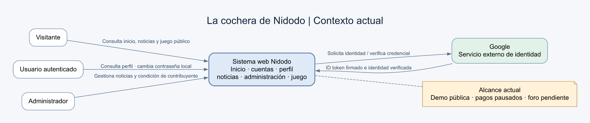
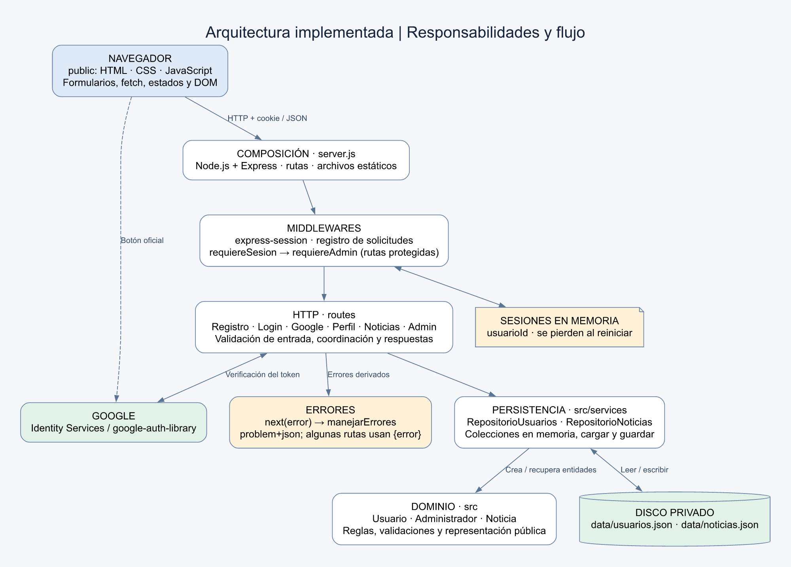
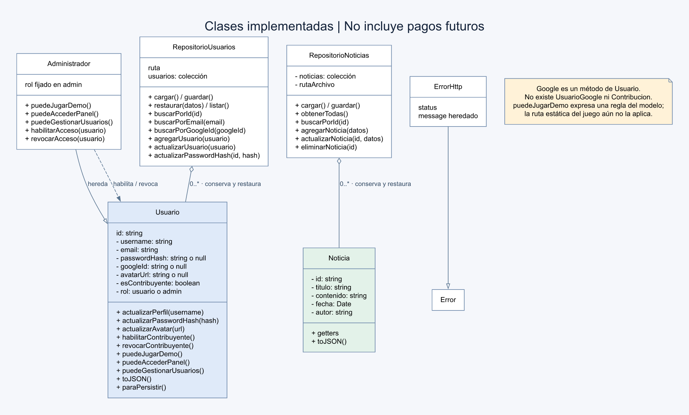
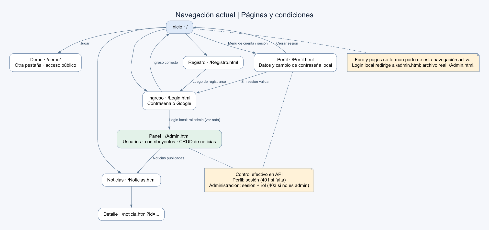

# Arquitectura

## Contexto actual

Visitantes consultan el inicio, noticias y juego. Usuarios autenticados consultan su perfil y las cuentas locales cambian su contraseña. Administradores gestionan noticias y la condición de contribuyente de cuentas comunes. Google aporta identidad verificada; no concede por sí mismo permisos administrativos.

Mercado Pago y foro no están activos. La condición de contribuyente del modelo no protege aún los archivos del juego. No se presenta esa propuesta futura como comportamiento implementado.

## Capas y responsabilidades

| Parte | Archivos | Responsabilidad |
| --- | --- | --- |
| Presentación | `public/*.html`, CSS y `public/js` | Formularios, estados, navegación y solicitudes HTTP. |
| Composición | `server.js` | Carga repositorios, configura Express y sesiones, monta routers y archivos estáticos. |
| HTTP | `routes` | Validaciones de entrada, coordinación de operaciones y respuestas. El proyecto no tiene una capa separada de controladores. |
| Transversal | `middlewares` | Sesión, rol, registro de solicitudes y errores comunes. |
| Dominio | `src/Usuario.js`, `Administrador.js`, `Noticias.js` | Datos, validaciones y comportamiento de las entidades. |
| Persistencia | `src/services/RepositorioUsuarios.js`, `RepositorioNoticias.js` | Colecciones en memoria, recuperación de entidades y archivos JSON. |
| Externo | Google Identity Services y `google-auth-library` | Obtención y verificación del ID token. |

Las rutas todavía contienen parte de la lógica de coordinación y validación. La carpeta `services` contiene repositorios; no se afirma que exista una arquitectura de servicios/controladores que no está implementada.

## Modelo de clases

`Administrador` hereda de `Usuario`, fija rol admin y agrega operaciones para habilitar o revocar condición de contribuyente. Google es un método de autenticación del mismo Usuario; no existe UsuarioGoogle. `Noticia` valida sus campos y es persistida por su repositorio. `ErrorHttp` agrega un estado HTTP a Error.

`Usuario.toJSON()` expone datos públicos; `paraPersistir()` agrega hash y Google ID para guardar. Los métodos de permiso del modelo expresan reglas, pero la entrega estática del juego no los consulta actualmente.

## Navegación

Las páginas HTML son estáticas. Abrir un HTML no concede acceso a su API: la comprobación efectiva se realiza en las peticiones del servidor. `Admin.html` tiene controles de interfaz, y `/api/admin` exige sesión y rol.

## Recorridos

**Registro:** Registro.js → POST `/api/registro` → validación → bcrypt.hash → Usuario → RepositorioUsuarios → archivo → respuesta pública 201. No abre sesión automáticamente.

**Login local:** Login.js → POST `/api/login` → buscar por email → bcrypt.compare → regenerar y guardar sesión → cookie → respuesta pública. GET `/api/login` consulta la sesión y devuelve usuario o null.

**Google:** LoginGoogle.js → GET configuración/nonce → Google Identity Services → ID token → POST Google → verificar audiencia e identidad → repositorio → sesión. No se guarda el token.

**Administración:** petición → express-session → requiereSesion (busca usuario y lo pone en req.usuario) → requiereAdmin (rol) → operación de la ruta. El primero rechaza con 401 y el segundo con 403; `next()` permite continuar.

**Noticia:** consulta pública → router → repositorio → representación JSON → DOM. Escrituras administrativas exigen permisos y persistencia.

**Errores:** `next(error)` → manejador común → problem+json. Algunas rutas responden `{error}` directamente; esta diferencia está documentada en el contrato.

## Límites para producción

- Sesiones en memoria: se pierden al reiniciar; cookie HttpOnly, SameSite=Lax y Secure en producción.
- JSON local: requiere conservar el disco, no hay transacciones ni coordinación entre instancias.
- Bind a `127.0.0.1`: debe revisarse para el hosting elegido; no hay endpoint de salud ni apagado SIGTERM explícito.
- Imports de Admin/Noticias en server.js tienen mayúsculas diferentes a los nombres de archivos versionados; Windows los resuelve, Linux puede fallar. Login.js también redirige a /admin.html, aunque el archivo es Admin.html. Esta rama documenta el problema sin cambiar código.
- Faltan suites específicas de noticias, administración y cambio de contraseña; no se afirma cobertura total.
- Lint tiene advertencias de complejidad; quedan pendientes simplificaciones que preserven comportamiento.

Decisiones: [sesiones](decisiones/001-sesiones-con-cookie.md) y [persistencia](decisiones/002-persistencia-json.md).
