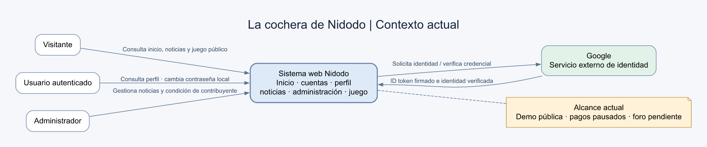
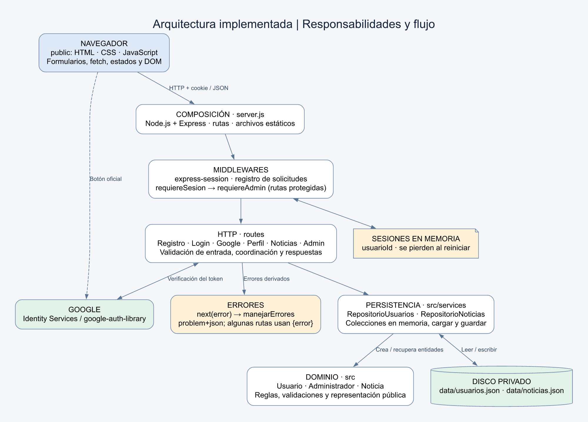
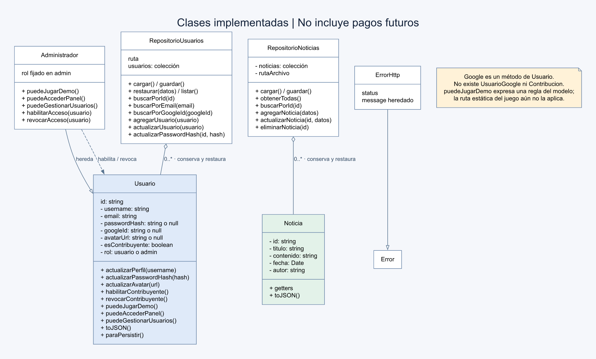
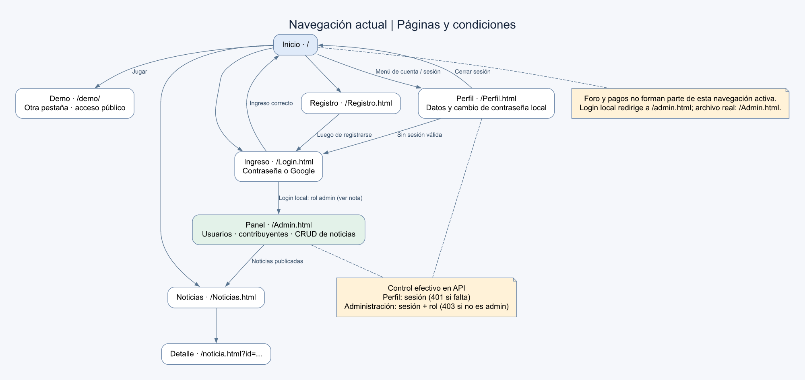

# Diagramas del proyecto

Las imágenes PNG de esta página se pueden ver directamente en GitHub. Hacé clic en cada imagen para abrirla en tamaño completo.

## Contexto del sistema

## Arquitectura por capas

## Clases del dominio

## Mapa de navegación

## Archivos editables

| Formato | Para qué sirve |
| --- | --- |
| `.png` | Imagen para consultar y presentar; se muestra arriba. |
| `.svg` | Imagen vectorial para ampliar o editar sin perder calidad. |
| `.dot` | Código fuente de Graphviz para modificar y regenerar el diagrama; se muestra como texto. |

Los archivos SVG y DOT de esta carpeta son versiones editables de los mismos cuatro diagramas.
