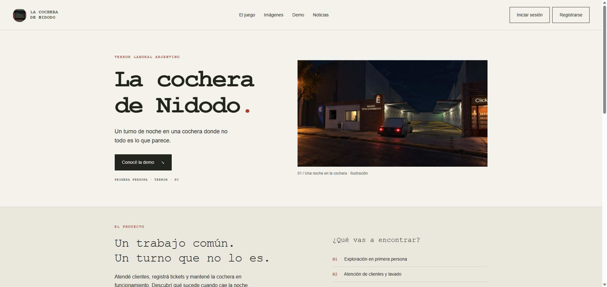

# Guía de uso

La cochera de Nidodo. Versión del sitio: 1.0.0. URL local: http://localhost:3000/. URL pública pendiente de documentar. Para instalación y variables, consultar el [README](../README.md).

## Visitantes

Inicio presenta el juego y sus imágenes. Noticias muestra el listado; elegí una publicación para ver su contenido. En la sección Demo, “Jugar en otra pestaña” abre la exportación web. El acceso actual es libre; contribuir no realiza ningún cobro. Mercado Pago y el foro están pendientes.

Las noticias públicas se muestran de a seis con controles Anterior y Siguiente cuando hay más de una página. Los listados administrativos muestran diez elementos por página.

## Registrarse e ingresar

1. Abrí Registrarse. Escribí nombre de usuario (3 a 20 caracteres), email, contraseña (8 a 20) y su confirmación.
2. Enviá el formulario. Si hay errores, corregí los campos indicados. Una cuenta registrada no se convierte en administrador.
3. Iniciá sesión con el email y la contraseña. Si devuelve credenciales inválidas, revisá ambos datos y el método de ingreso.
4. También podés elegir el botón oficial de Google y completar la selección de cuenta. Si el correo ya pertenece a una cuenta local, usá el método original: no hay vinculación automática.

El perfil aparece desde el menú de cuenta. En cuentas con contraseña local permite cambiarla ingresando la actual y una nueva diferente de 8 a 20 caracteres. No hay recuperación de contraseña por email. Las cuentas solo Google no cambian su contraseña de Google desde esta página.

“Cerrar sesión” termina la sesión, no borra la cuenta. Si el servidor reinicia o la sesión vence, ingresá de nuevo.

## Administradores

La primera cuenta se crea con `npm run crear-admin`, siguiendo el README. Las credenciales se definen localmente; no están incluidas en esta guía ni se publican. Si se creó con el servidor abierto, reinicialo.

1. Iniciá sesión como administrador y abrí `/Admin.html`.
2. Consultá el resumen y el listado de usuarios.
3. Habilitá o revocá la condición de contribuyente de una cuenta común. No se permite modificar la de otro administrador y esta condición aún no bloquea el juego público.
4. Publicá una noticia con título de 5 a 100 caracteres y contenido de 10 a 2000.
5. Desde el listado administrativo podés editar o eliminar noticias. Confirmá con cuidado: el proyecto no ofrece papelera de noticias.

Una cuenta común recibe 403 al pedir recursos administrativos; sin sesión se recibe 401. Esos controles se ejecutan en el servidor aunque se escriba la URL directamente.

## Jugar

Esperá la primera descarga. Se necesita teclado y mouse: WASD para caminar, E para interactuar y Escape para pausa. La plantilla ofrece pantalla completa. No hace falta instalar Unity. La verificación histórica no cubrió de principio a fin las siete noches.

## Si algo falla

| Síntoma | Qué hacer |
| --- | --- |
| No abre localhost | Comprobar que el servidor esté iniciado en esa PC y que el puerto sea el correcto. |
| Credenciales inválidas | Revisar email, contraseña y si la cuenta se creó con Google. |
| Sesión vencida o 401 | Volver a ingresar. |
| Sin permiso o 403 | Usar una cuenta autorizada; registrar una cuenta común no concede rol admin. |
| Google tarda o falla | Recargar el login y reintentar; verificar conexión y origen autorizado. |
| Noticia inexistente | Volver al listado; puede haberse eliminado. |
| Fallo interno | Conservar el código de solicitud si aparece y describir la operación al equipo. |

## Preguntas frecuentes

**¿Cerrar sesión elimina mis datos?** No. Los usuarios persisten en el archivo del servidor.

**¿El aporte habilita la demo?** Todavía no: el juego es público en esta versión.

**¿Por qué volvió a pedir ingreso?** Las sesiones vencen y se pierden si el servidor reinicia.

Para informar errores, usá los [issues del proyecto](https://github.com/PDAW-Proyectos/pdaw-2026-proyfinal-g09/issues). No publiques contraseñas, cookies ni credenciales.
